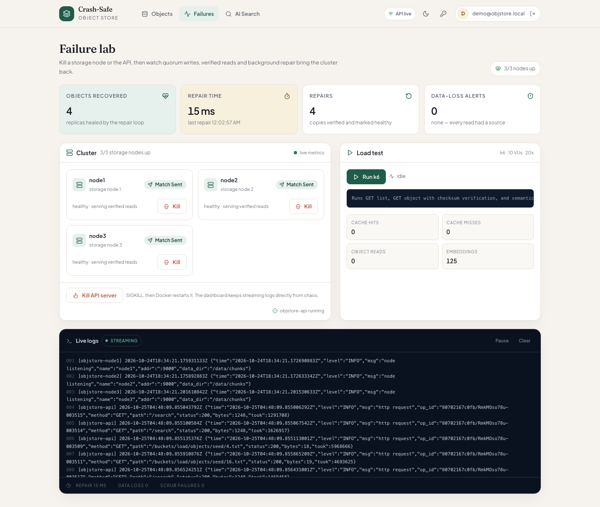
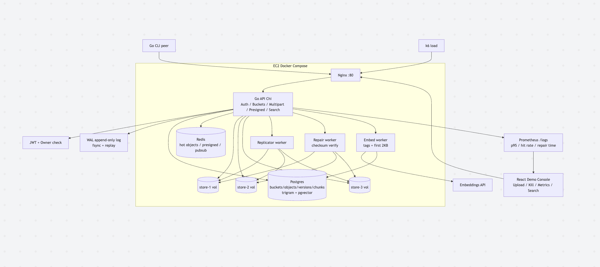

# Crash-Safe Object Store

An S3-style object store built as an internals playground: immutable
SHA-256-checksummed chunks on three storage nodes, PostgreSQL metadata, a
custom write-ahead log, and background workers that repair the cluster while
you watch.

It is a demo, not an AWS replacement. The point is the failure path: kill a
node or the API, keep writing, and see verified reads and background repair put
the cluster back together.



## What works

- JWT auth, owner-scoped buckets, single PUT and multipart upload with resume
- N=3 replicas, W=2 acknowledged writes, R=1 SHA-256-verified read
- Deterministic UUIDv5 chunk IDs, so retries hit the same immutable chunk
- Verified reads with replica fallback; bad copies become `corrupt` or `missing`
- HTTP Range reads mapped onto chunks
- Presigned GET URLs with a 7-day cap
- Write-ahead log with group commit, segment rotation, torn-tail truncation and
  idempotent replay
- Crash injection at `after_wal_sync`, `after_node_ack` and `after_db_commit`
- Health checker, replicator, repair, scrubber and WAL-logged garbage collection
- Version history and rollback (pointer moves, no bytes copied)
- Redis metadata cache (60 s pointer TTL) and immutable small-object cache
- Prometheus metrics plus a WebSocket feed
- Chaos controller: kill/heal a node, SIGKILL the API, run k6, stream logs
- React dashboard with Objects, Failures and AI Search tabs, light and dark
- pgvector semantic search with an OpenAI embedder or a deterministic local
  fallback, plus an at-least-once embedding queue and sweeper
- Single-instance production Compose overlay, Caddy TLS, deploy workflow and a
  post-deploy smoke test

Phases 0–10 are complete. Phase 11's deploy artifacts are in the repo; the
actual EC2 instance is provisioned outside this repository and is not claimed
as deployed here.

## Quick start

```bash
cp .env.example .env
# Fill POSTGRES_PASSWORD, JWT_SECRET, PRESIGN_SECRET and DEMO_TOKEN.
make up
open http://localhost:8000
```

The edge container serves the dashboard, proxies `/api` to the API and `/chaos`
to the demo controller. Postgres, Redis and the three storage nodes are not
published to the host. The API is available through the edge at
`http://localhost:8000/api`.

Create an account, or use **Load demo data** with the `DEMO_TOKEN` from `.env`
to seed 100 mixed-size objects and sign in as `demo@objstore.local`.

### Run the failure demo

1. Open **Failures** and make sure the demo token is saved.
2. Kill `node1`. The cluster card flips to two nodes up.
3. Upload an object. The write still succeeds with W=2 acks.
4. Heal `node1`. The replicator/repair loop copies the missing replica.
5. Watch `objects_recovered`, repair time and the live logs. The smoke test
   waits for all three replicas to be healthy and compares their checksums.
6. **Kill API server** sends a real SIGKILL and Docker restarts the container;
   the dashboard keeps streaming logs directly from the chaos controller.

## Architecture



### Write path

1. Validate the upload and compute the body SHA-256.
2. Compute `uuidv5(uploadID + ":" + partNo + ":" + sha256hex)`.
3. Append `BEGIN_PUT` to the WAL and fsync before touching a node.
4. Write in parallel to healthy nodes; each node verifies the checksum and
   fsyncs the file and directory.
5. Require W=2 acknowledgements.
6. Commit chunk, part and replica rows in one Postgres transaction.
7. Append `COMMIT_PUT` and return the chunk SHA-256 as the ETag.

A small PUT is init + one part + complete, so there is one write path.

### Read path

The current version comes from Redis then Postgres. Each chunk is fetched from
a healthy replica, hashed before the bytes leave the API, and retried from
another replica on failure. Transport failures are marked `missing`; checksum
failures are marked `corrupt`.

### State ownership

PostgreSQL is the only source of truth for buckets, objects, versions, chunk
placement and node health. Chunk bytes live on node disks. The WAL records
node-file intent only and never stores chunk bytes. Redis caches and queues are
derived data and can be flushed.

## API sketch

| Method | Path | Purpose |
|---|---|---|
| `POST` | `/auth/register`, `/auth/login` | Issue a 15-minute JWT |
| `GET/POST` | `/buckets` | List or create buckets |
| `PUT/GET/DELETE` | `/buckets/{bucket}/objects/{key}` | Objects and Range reads |
| `GET` | `/buckets/{bucket}/versions?key=` | Version history |
| `POST` | `/buckets/{bucket}/rollback` | Move the current-version pointer |
| `POST` | `/buckets/{bucket}/uploads` | Start multipart |
| `PUT` | `/buckets/{bucket}/uploads/{id}/parts/{n}` | Upload one chunk |
| `POST` | `/buckets/{bucket}/uploads/{id}/complete` | Commit the version |
| `POST` | `/buckets/{bucket}/presign` | Stateless presigned GET |
| `GET` | `/search?q=&limit=` | pgvector cosine search |
| `GET` | `/metrics`, `/stats`, `/ws/metrics` | Observability |
| `POST` | `/admin/reset`, `/admin/seed` | Demo mode only, token required |

## Testing

```bash
make test         # go vet + all tests with -race
make lint         # golangci-lint
make crash-test   # WAL truncation + subprocess crash/recovery harness
make e2e          # Compose failure smoke test
make compose-config
```

Database tests use `TEST_DATABASE_URL` or `DATABASE_URL` and skip only when
neither is set. `make up` publishes Postgres on port 5433 for host-run tests.

The test suite covers the WAL codec at every truncation offset, the three crash
points, idempotent multipart completion, checksum corruption and repair,
pending-replica replication, GC of staged chunks and old orphan files,
version rollback, cache invalidation, duplicate embedding processing and search
ranking.

The Compose smoke test (`deploy/smoke.sh`) registers a user, uploads and
compares SHA-256, kills a node, writes during the outage, heals it, waits for
three healthy replicas, compares chunk checksums on all three nodes and reads
the recovered object.

## Load test

k6 run from a laptop against the local Docker Compose stack (10 VUs, 20 s,
including list, verified GET and search):

```
http_reqs........: 2692   131.19/s
http_req_failed..: 0.00%  0 out of 2692
http_req_duration: avg=8.22ms  p(90)=10.65ms  p(95)=15.83ms
checks...........: 3561/3561 passed
```

This is a local sanity number, not a production capacity claim. k6 competes
with the stack for CPU, and EBS fsync latency on the real instance will be
higher than local disk. Run k6 from another machine before quoting throughput.

## Deploy

Production is one Ubuntu EC2 instance running the same Compose files plus
`deploy/docker-compose.prod.yml`. The overlay removes published database,
Redis, node and API ports, bind-mounts `/srv/objstore/*` for durable data, adds
log rotation and serves TLS through Caddy.

```bash
IMAGE_TAG=<git-sha> docker compose \
  --project-directory . \
  -f deploy/docker-compose.yml \
  -f deploy/docker-compose.prod.yml up -d
```

GitHub Actions (`.github/workflows/deploy.yml`) builds and pushes five images
to GHCR, then SSHes to the host, checks out the same SHA, runs the migration
one-shot, pulls, restarts and runs `deploy/smoke.sh`. Required repository
secrets: `DEPLOY_HOST`, `DEPLOY_USER`, `DEPLOY_SSH_KEY`, and optionally
`GHCR_USER` / `GHCR_TOKEN`. Required variable: `SITE_ADDRESS`.

The host needs a `.env` with `chmod 600` (never committed) containing the
database password, JWT secret, presign secret, demo token, TLS email and image
coordinates. Migrations are forward-only; roll back by redeploying a previous
image tag.

## Honest limitations

- All three storage nodes share one EC2 instance, one disk and one failure
  domain. The failure demo stops containers; it is not real fault isolation.
- k6 on the same instance competes for CPU. The numbers above are from a local
  laptop for that reason.
- EBS is network-attached storage. Measure WAL fsync latency on the real
  instance before making throughput claims.
- Version history is retained. Deleting an object writes a tombstone; GC
  collects staged/abandoned chunks and orphan files, not old readable versions.
- The AI search embedder falls back to a lexical hash embedding when no OpenAI
  key is set. It is deterministic and useful for the demo, not a semantic model.

## Repository layout

```
cmd/api        HTTP API, coordinator, GC and WAL owner
cmd/node       storage node
cmd/worker     health, replicator, repair, scrubber, embeddings
cmd/chaos      Docker/k6/log-stream demo controller
internal/      auth, objects, upload, coordinator, wal, placement, replicator,
               repair, scrubber, gc, health, cache, search, metrics, presign
db/migrations  forward-only SQL migrations
db/queries     sqlc queries
dashboard/     React + TypeScript dashboard
deploy/        Compose, Caddy, k6, smoke test
docs/          architecture image, screenshots and decision records
```
